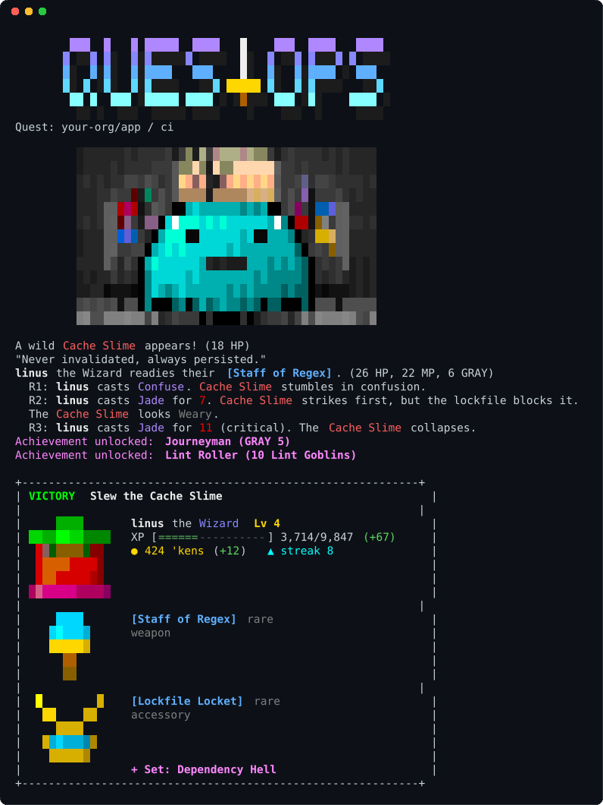
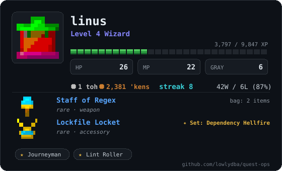

<p align="center"></p>

<p align="center"><b>Every CI run is a dungeon encounter.</b><br>Green builds win fights. Red builds lose them. Your hero grows with you.</p>

<p align="center"></p>

QuestOps adds one classic text-dungeon encounter to the end of your workflow. It reads how the job went, rolls a monster, a treasure chest or a trap, and plays it out in the job log. Your hero levels up, earns 'kens (nobody knows what for), picks up loot and keeps a streak, all saved to a branch in your own repository.

There's nothing to host and no account to make. It's one step in your workflow.

## Where it comes from

QuestOps stands on the shoulders of giants. From my childhood of text adventures, MUDs, and JRPGs it borrows the short scene of a monster, a few lines of narration, dice rolls, and a role-playing character sheet.

I was once fascinated with idle RPGs and this feels like an extension as a passive fantasy experience, while allowing your technical talent to still drive outcomes. The hero advances on its own while you do work, and the game only asks that you keep merging.

The twist is that your CI pipeline is the dungeon main. Passing builds win fights, failing builds lose them, and the d20 decides the rest.

## Add it to a workflow

```yaml
permissions:
  contents: write # saves your hero to the questops-data branch
  actions: read # reads how the job went

steps:
  - uses: lowlydba/quest-ops@v1 # anywhere in the job, even first
  - run: npm test
```

The encounter happens when the job finishes, after every other step, so it knows whether your tests passed. It shows up in three places:

- The job log, in full colour pixel art.
- The job summary.
- The `questops-data` branch, which has a Hall of Heroes with every player's card.

## How it plays

- A failing run is always a loss. The monster wins, the chest bites and the trap springs.
- A passing run is _usually_ a win.
- Your hero persists. Class and face come from your username. Levels come slowly, gear is equipped automatically, and achievements are earned over hundreds of runs.
- Re-running a job doesn't farm wins. Each commit counts once per hero.
- Bots don't quest. Dependabot and friends roll for a traveling merchant instead, who buys unused loot from a random hero's bag.

## Meet the locals

| Lint Goblin | Cache Slime | Wraith of the Flaky Test | Ancient Wyrm of Legacy Prod |
|:-:|:-:|:-:|:-:|
|  |  |  |  |
| *"Mmm, trailing whitespace."* | *"Never invalidated, always persisted."* | *"Pass... or fail... who can say?"* | *"YOU SHALL. NOT. MERGE."* |

Tougher "Senior" and "Skip Level" versions turn up as you increase your level. The data branch carries a full bestiary and reliquary, with lore for every monster and item.

## Show off your hero



Every quest refreshes your character card and a set of [shields.io](https://shields.io/badges/endpoint-badge) style badges on the data branch. Embed them anywhere:

```markdown

```

They're static files, so there's no server, and they're as fresh as your last build.

<br clear="right">

## Try the live demo

This repository plays its own game on every push to main, so its data branch is a working example you can browse:

- [Hall of Heroes](https://github.com/lowlydba/quest-ops/tree/questops-data): the leaderboard and every hero's card.
- [Bestiary and reliquary](https://github.com/lowlydba/quest-ops/blob/questops-data/lore/README.md): lore for every monster, item, set and spell.
- [Quest log](https://github.com/lowlydba/quest-ops/blob/questops-data/QUESTLOG.md): every encounter so far.

Pull requests get a one-off encounter as a single comment that later pushes edit (`comment: true`), without touching the leaderboard.

## Learn more

- [Setup and configuration](docs/setup.md): inputs, permissions, the data branch, other CI systems, Docker and the CLI.
- [Recipes](docs/recipes.md): one leaderboard, several per repository, or one shared across repositories.
- [How the game works](docs/gameplay.md): classes, stats, levels, loot, odds and the merchant.
- [Development](docs/development.md): running the tests and how the project is put together.

QuestOps runs on Python's standard library and a small Node shim, with no dependencies to install.
