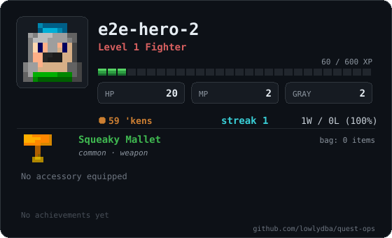
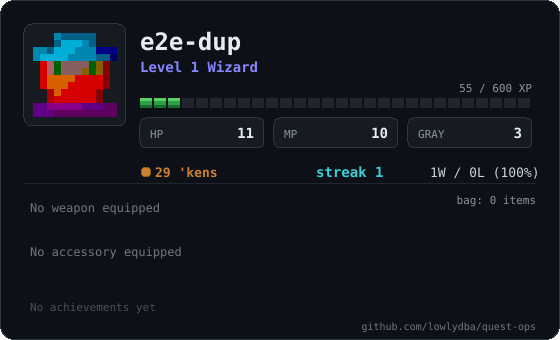
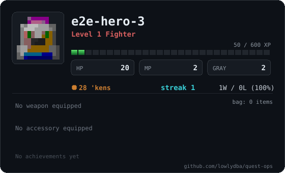
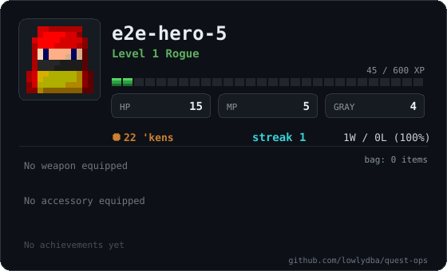
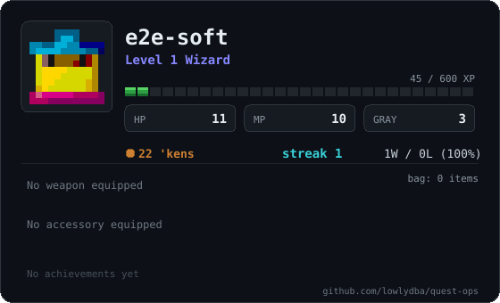
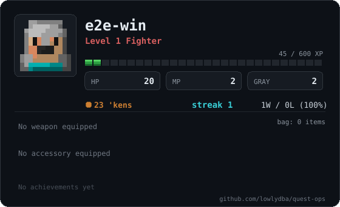
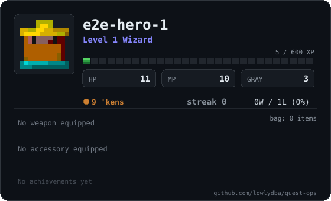
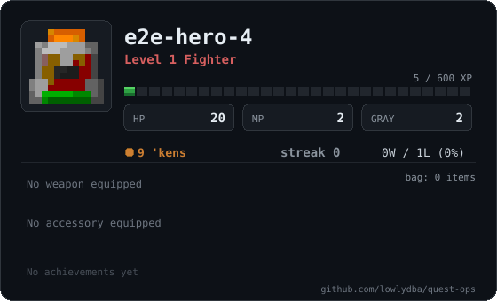
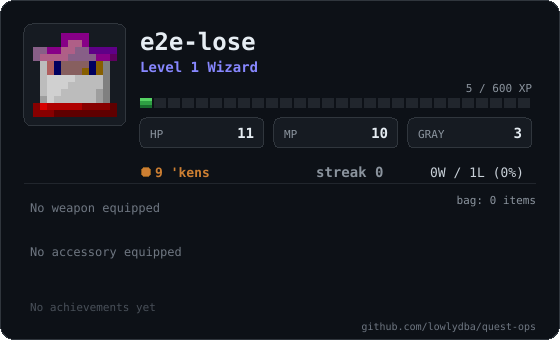

# Hall of Heroes

| # | Hero | Class | Lv | XP | W/L | Streak | Equipped |
|---|---|---|---|---|---|---|---|
| 🥇 | [e2e-hero-2](characters/e2e-hero-2.svg) | Fighter | 1 | 60 | 1/0 | 1 | [Squeaky Mallet](lore/items/squeaky-mallet.md) |
| 🥈 | [e2e-dup](characters/e2e-dup.svg) | Wizard | 1 | 55 | 1/0 | 1 | - |
| 🥉 | [e2e-hero-3](characters/e2e-hero-3.svg) | Fighter | 1 | 50 | 1/0 | 1 | - |
| 4. | [e2e-hero-5](characters/e2e-hero-5.svg) | Rogue | 1 | 45 | 1/0 | 1 | - |
| 5. | [e2e-soft](characters/e2e-soft.svg) | Wizard | 1 | 45 | 1/0 | 1 | - |
| 6. | [e2e-win](characters/e2e-win.svg) | Fighter | 1 | 45 | 1/0 | 1 | - |
| 7. | [e2e-hero-1](characters/e2e-hero-1.svg) | Wizard | 1 | 5 | 0/1 | 0 | - |
| 8. | [e2e-hero-4](characters/e2e-hero-4.svg) | Fighter | 1 | 5 | 0/1 | 0 | - |
| 9. | [e2e-lose](characters/e2e-lose.svg) | Wizard | 1 | 5 | 0/1 | 0 | - |

<table>
<tr><td width="50%" valign="top"></td><td width="50%" valign="top"></td></tr>
<tr><td width="50%" valign="top"></td><td width="50%" valign="top"></td></tr>
<tr><td width="50%" valign="top"></td><td width="50%" valign="top"></td></tr>
<tr><td width="50%" valign="top"></td><td width="50%" valign="top"></td></tr>
<tr><td width="50%" valign="top"></td><td width="50%"></td></tr>
</table>

📖 [Bestiary and reliquary](lore/README.md) · 📜 [Quest log](QUESTLOG.md)
