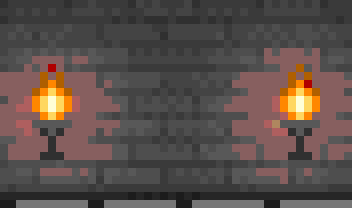
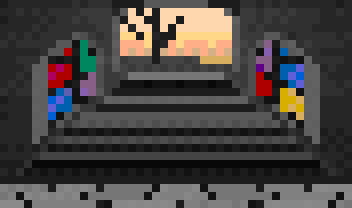
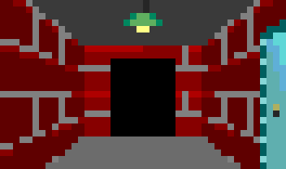
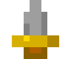

# 📖 Lore

## Bestiary
Every foe comes in three flavours: the base creature, a **Senior** version (from hero level 5) and a **Skip Level** version (from level 10).

|  | Monster | Found |
|---|---|---|
|     | [Lint Goblin](monsters/lint-goblin.md) | level 1, tougher variants later |
|     | [Cache Slime](monsters/cache-slime.md) | level 1, tougher variants later |
|     | [Wraith of the Flaky Test](monsters/wraith-of-the-flaky-test.md) | level 3, tougher variants later |
|     | [Ancient Wyrm of Legacy Prod](monsters/ancient-wyrm-of-legacy-prod.md) | level 6, tougher variants later |
|     | [Mimic](monsters/mimic.md) | treasure chests, when the workflow fails |

## 🚪 Rooms
Each foe stands in one of 4 rooms. They are scenery only.

|  | Room | Lore |
|---|---|---|
|  | [The Carpeted Corridor](rooms/corridor.md) | A long stone passage with a red runner that nobody has vacuumed since the last migration. The far end is dark in the way unmonitored services are dark. |
|  | [The Torch Hall](rooms/torches.md) | Two sconces flicker on a wall of old stone, the last evidence of a lighting migration that never finished. Everything here is warm, and nothing is documented. |
|  | [The Stair Landing](rooms/stairs.md) | A landing partway up a flight of stairs, with a daylit doorway at the top and stained glass that nobody owns. Everyone agrees it leads somewhere, and nobody has filed a ticket to find out where. |
|  | [The Castle Corridor](rooms/castle.md) | A brick corridor with flat grey floors and a steel door set into the right wall, built like a game from 1992. It ends in black, because the roadmap does. |

## 🧳 Wanderers
|  | Wanderer | Appears |
|---|---|---|
|  | [Traveling Merchant](npcs/traveling-merchant.md) | on bot runs (about 5%), buying what you are not wearing |

## 🎒 Reliquary

### ⚔️ Weapons
Weapons are class-locked, and you wield one at a time. Staffs hit weakly but let a Wizard cast spells. Daggers and mallets hit hard, with no spells.

|  | Weapon | Class | Kind | Damage |
|---|---|---|---|---|
|  | [Squeaky Mallet](items/squeaky-mallet.md) | Fighter | 🟢 common mallet | +2 |
|  | [Local Bludgeon](items/local-bludgeon.md) | Fighter | 🟡 uncommon bludgeon | +0 |
|  | [Hard Reset](items/hard-reset.md) | Fighter | 🔵 rare mallet | +6 |
|  | [Force Merge](items/force-merge.md) | Fighter | 🔵 rare mallet | +4 |
|  | [Rusty Dagger](items/rusty-dagger.md) | Rogue | 🟢 common dagger | +2 |
|  | [Hotfix](items/hotfix.md) | Rogue | 🔵 rare dagger | +5 |
|  | [Sudo Shiv](items/sudo-shiv.md) | Rogue | 🟣 legendary dagger | +7 |
|  | [Intern's Staff](items/intern-s-staff.md) | Wizard | 🟢 common staff | +0 |
|  | [Staff of Eventual Consistency](items/staff-of-eventual-consistency.md) | Wizard | 🔵 rare staff | +2 |
|  | [Staff of Regex](items/staff-of-regex.md) | Wizard | 🔵 rare staff | +1 |

### 💍 Accessories
Any class can wear these, one at a time.

|  | Accessory | Kind |
|---|---|---|
|  | [Lucky Rubber Duck](items/lucky-rubber-duck.md) | 🟢 common charm |
|  | [Dependabot Charm](items/dependabot-charm.md) | 🟡 uncommon charm |
|  | [Cloak of Mild Inconvenience](items/cloak-of-mild-inconvenience.md) | 🟡 uncommon cloak |
|  | [Ring of Retries](items/ring-of-retries.md) | 🔵 rare ring |
|  | [Lockfile Locket](items/lockfile-locket.md) | 🔵 rare locket |
|  | [Crown of the Main Branch](items/crown-of-the-main-branch.md) | 🟣 legendary crown |

### 🔗 Sets
Wear both halves of a pair and the set bonus applies in combat.

| Set | Weapon | Accessory | Effect | Lore |
|---|---|---|---|---|
| **Hotfix Friday** | Hotfix | Cloak of Mild Inconvenience | Hotfix backfires are absorbed: no damage to you. | Ship it on Friday, wrap it in a cloak, and call the incident 'mild'. The postmortem has been rescheduled indefinitely. |
| **Dependency Hellfire** | Staff of Regex | Lockfile Locket | The Staff of Regex's 'matches too much' never hurts you. | The lockfile pins every wildcard to a version nobody dares to bump. It is stable, in the way a fossil is stable. |
| **Retry Loop** | Hard Reset | Ring of Retries | Removes the Ring of Retries' -2 to hit in the early rounds. | Turn it off, rewind it, turn it off again. Eventually the loop exits, mostly out of embarrassment. |
| **Pair Programming** | Squeaky Mallet | Lucky Rubber Duck | +1 to hit in round 1. | One of you types and the other squeaks. Somehow the first commit is still the best one. |
| **Zero Trust** | Sudo Shiv | Lockfile Locket | Ignores armour for the whole fight: your attacks cannot miss. | Verify everything, pin everything, and stab anyone who asks for a token. Nobody has ever filed a ticket about it twice. |

## 📜 Spellbook
Wizards with a staff unlock 7 spells, from Jade at level 1 to Zoltraak at level 7. See the full [Spellbook](spellbook.md).

| Spell | Unlocks | MP |
|---|---|---|
| Jade | level 1 | 2 |
| Confuse | level 2 | 2 |
| Hard Block | level 3 | 2 |
| Refactor | level 4 | 3 |
| Supply Chain Attack | level 5 | 4 |
| Pre-commit | level 6 | 5 |
| Zoltraak | level 7 | 4 |

[← Hall of Heroes](../README.md)
