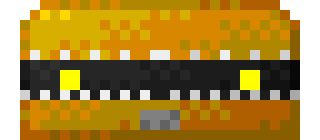
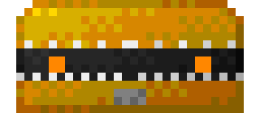
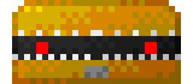

# Mimic

> Looks like a feature flag and behaves like a rewrite. It bites anyone who opens it without reading the diff first. Learning [Mikheit](https://frieren.fandom.com/wiki/Spells#Named_Other_Spells "Spells") sure would be helpful.

Appears inside treasure chests, whenever the workflow fails. You can't slay one; you can only survive it.

## 🎖️ Variants
|  | Variant | From | HP | Reward |
|---|---|---|---|---|
|  | **Mimic** | level 1 | - | - |
|  | **Senior Mimic** | level 5 | - | - |
|  | **Skip Level Mimic** | level 10 | - | - |

The only difference between the variants is the look in their eyes.

[← Back to the bestiary](../README.md)
