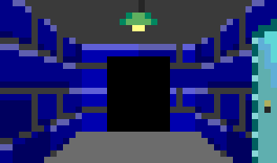

# The Castle Corridor

> A brick corridor with flat grey floors and a steel door set into the right wall, built like a game from 1992. It ends in black, because the roadmap does.

Rooms are scenery. Every foe stands in one, picked from a hash of the run's seed, and it changes nothing about the fight or the dice.

## Variant

Slimes and wyrms prefer the same corridor in dark blue stone, which clashes less with their complexions.

[← Back to the lore](../README.md)
